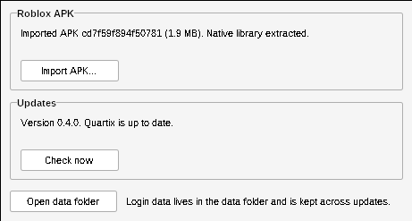

# Quartix

A native Win32 tool for **Windows XP x64** that manages Roblox Android APKs: it imports
an APK, keeps app data (including login data) in a folder that updates never touch,
and updates itself safely.

## Using it

Double-click `Quartix.exe` to open its window. It shows the imported APK, imports a
new one, and checks for updates every time it starts. When a newer signed release
exists it installs it and restarts by itself.



Everything is also available from a command prompt:

```
Quartix.exe help                         list the commands
Quartix.exe info                         show install and data locations
Quartix.exe import-apk roblox.apk        import the x86_64 Roblox APK (or .apks/.xapk/.apkm bundle)
Quartix.exe apk-ls roblox.apk            list what is inside an APK or bundle
Quartix.exe update                       download and install the latest signed release
Quartix.exe update --check               only say whether an update is available
Quartix.exe apply-update new.exe new.exe.sig  install a signed, newer build from local files
```

Quartix does not ship or download the Roblox APK; you provide it. A plain APK or
an APK bundle (`.apks`, `.xapk`, or an unencrypted `.apkm`) both work, as long as it
includes the x86_64 build of the native library. For a bundle, every APK inside is
kept side by side, the base one is saved as `base.apk`, and the library is taken
from the x86_64 split.

### Where things live

| Location | What | Touched by updates |
| --- | --- | --- |
| install dir (next to `Quartix.exe`) | the program | yes |
| `%APPDATA%\Quartix\app\com.roblox.client` | the Roblox app's private storage, including its login session | **never** |
| `%APPDATA%\Quartix\apk` | imported APKs and extracted native libraries | never |
| `%APPDATA%\Quartix\logs` | logs | never |

An update only swaps `Quartix.exe` (rename aside, move new one in, roll back on
failure). The data directory can be moved with the `QUARTIX_DATA_DIR` environment
variable.

### Updates

`Quartix.exe update` fetches `Quartix.exe.sig` from the latest GitHub release over
TLS 1.2 (bundled BearSSL, since XP x64 has none; certificates are checked against
the bundled Mozilla CA list and the host name). It installs the release only if the
signature is made by the project's Ed25519 key, the download matches the signed
SHA-256, and the version is newer than the running one, so downgrades are refused.
A build made without a key refuses all updates.

### Releasing

One-time setup: the private signing key goes in the repository secret
`QUARTIX_SIGNING_KEY` (Settings > Secrets and variables > Actions; paste the whole
`.pem` file). Its public half is `keys/update_pubkey.txt`.

To release: bump the version in `src/version.h`, merge, then run the **release**
workflow from the Actions tab. It builds, runs the tests, signs, checks the
signature against `keys/update_pubkey.txt` and publishes release `v<version>`.

To change keys: commit the new public key, then sign that one release with the
old key. Installed copies trust it because the old key signed it, and trust only
the new key from then on.

Manual signing still works: `python3 tools/sign_update.py sign <key.pem>
build/Quartix.exe <version>`.

## Building

Cross-compiled on Linux with mingw-w64 against `msvcrt.dll`, which XP x64 ships:

```
sudo apt install gcc-mingw-w64-x86-64 wine64 python3-cryptography xvfb
make            # build/Quartix.exe
make check      # verify the image targets NT 5.2 and imports nothing newer
xvfb-run -a make test WINE=/usr/lib/wine/wine64   # window tests need a display
```

## Roadmap

- **Done:** XP x64 executable, install/data split, APK import, signed automatic
  updates over HTTPS with downgrade protection, a native window, release workflow,
  CI that checks XP compatibility and runs tests under Wine.

## Third-party code

[Monocypher](https://monocypher.org/) 4.0.2 (BSD-2-Clause / CC0) for Ed25519,
vendored unmodified in `third_party/monocypher`.
[miniz](https://github.com/richgel999/miniz) 3.0.2 (MIT), only its inflate, for
compressed APK and bundle entries, vendored unmodified in `third_party/miniz`.
[BearSSL](https://bearssl.org/) 0.6 (MIT) for TLS, vendored unmodified in
`third_party/bearssl`. CA list generated from the Mozilla bundle by
`tools/gen_trust_anchors.sh`.

## License

GPLv3, see [LICENSE](LICENSE).
